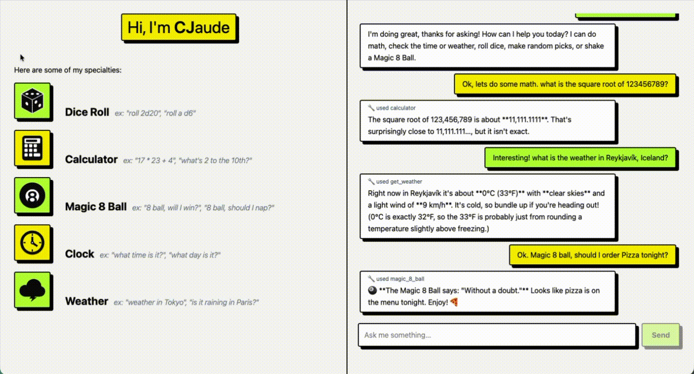

# CJaude

CJaude is a small AI agent you can chat with in the browser. It's powered by Claude and has a set of tools it can call when a question needs real randomness, real math, or live data.

The project has a React frontend (`frontend/`) and a Python backend (`backend/`).

## Demo

Hover over a tool on the left and its tile rolls back and forth across the row:



Ask something in the chat, and each reply shows which tools CJaude used:


## What CJaude can do

| Tool | What it does | Try asking |
|---|---|---|
| Dice roll | Rolls any number of dice and adds them up | "roll 2d20" |
| Calculator | Works out arithmetic expressions | "17 * 23 + 4" |
| Magic 8 Ball | Answers yes/no questions with a classic 8 Ball reply | "8 ball, should I nap?" |
| Random pick | Chooses one option from a list | "pick pizza or tacos for me" |
| Clock | Gets the current date and time | "what day is it?" |
| Weather | Gets current conditions for a city from [Open-Meteo](https://open-meteo.com/) | "weather in Tokyo" |

On desktop, you can drag the divider between the two sections to resize them.

## How it works

1. The browser sends the conversation to the backend.
2. The backend sends it to Claude, along with descriptions of the tools.
3. If Claude asks for a tool, the backend runs it and sends back the result.
4. Steps 2 and 3 repeat until Claude has a final answer, up to 10 times.
5. The browser shows the reply and keeps the full history, including tool calls, for the next message.

## Built with

- **Frontend:** React, Vite, Tailwind CSS, GSAP
- **Backend:** Python, FastAPI, Anthropic Python SDK

## Running it locally

You'll need Python, Node.js, and an [Anthropic API key](https://console.anthropic.com/). The weather tool doesn't need a key.

**1. Start the backend** from the project root:

```bash
cd backend
python3 -m venv .venv
source .venv/bin/activate
pip install -r requirements.txt
echo "ANTHROPIC_API_KEY=your-key-here" > .env
uvicorn main:app --reload
```

**2. Start the frontend** in a second terminal, also from the project root:

```bash
cd frontend
npm install
npm run dev
```

**3. Open the URL Vite prints**, usually http://localhost:5173. Requests to `/api` are forwarded to the backend on port 8000, so both need to be running.

To chat in the terminal without the frontend, run `python cli.py` from `backend/` with the virtual environment active.

## Adding a tool

Tools live in `backend/tools.py`. To add one:

1. Add its name, description, and inputs to `TOOLS`.
2. Write the Python function.
3. Add a branch for it in `execute_tool`.

Running `python tools.py` from `backend/` tries out the tools without calling Claude.
